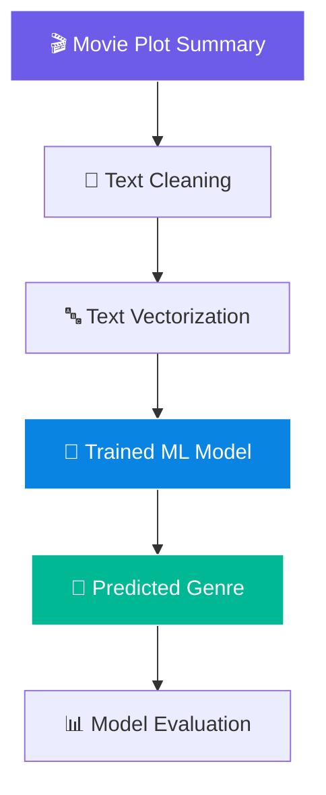

# 🎬 Movie Genre Classification
### *Predict the genre. Understand the story. Explore the magic of movies.*

<p align="center">
  
</p>

<p align="center">
  
  
  
  
</p>

---

## 🍿 About the Project

**Movie Genre Classification** is a machine learning project that predicts movie genres from plot summaries using Natural Language Processing (NLP).

The system processes textual descriptions, extracts meaningful features, and uses a trained machine learning model to classify movies into their appropriate genres.

<p align="center">
  
</p>

> 🎯 **Goal:** Turn movie plot descriptions into meaningful genre predictions with the power of NLP and machine learning.

## ✨ Features

| Feature | Description |
|---|---|
| 🧹 Text Preprocessing | Clean and normalize plot summaries. |
| 🔤 NLP Feature Extraction | Convert text into numerical features. |
| 🤖 Genre Prediction | Predict genres using a trained ML model. |
| 📊 Model Evaluation | Evaluate performance using appropriate metrics. |
| 🎞️ Text Classification | Learn patterns from movie descriptions. |

## ⚙️ How It Works



### 🔍 Classification Pipeline

1. **Input:** Provide a movie plot summary.
2. **Preprocessing:** Remove unwanted characters and normalize the text.
3. **Feature extraction:** Transform text into numerical vectors using a technique such as TF-IDF.
4. **Prediction:** Pass the features to the trained classification model.
5. **Output:** Display the predicted genre or genres, depending on the model.

## 🛠️ Technologies Used

- 🐍 **Python** — Core programming language
- 🐼 **Pandas** — Dataset loading and manipulation
- 🧠 **Scikit-learn** — Feature extraction, model training, and evaluation
- 📝 **NLP** — Text preprocessing and feature engineering
- 📊 **Matplotlib / Seaborn** — Optional evaluation visualizations

## 🚀 Installation & Setup

### 1. Clone the repository

```bash
git clone https://github.com/YOUR-USERNAME/movie-genre-classification.git
cd movie-genre-classification
```

### 2. Create a virtual environment (recommended)

```bash
python -m venv venv
```

Activate it:

**Windows**
```bash
venv\Scripts\activate
```

**macOS / Linux**
```bash
source venv/bin/activate
```

### 3. Install dependencies

```bash
pip install pandas scikit-learn
```

Install any additional dependencies required by your implementation.

### 4. Run the project

Run the Python entry-point file used in your repository. For example:

```bash
python main.py
```

> 💡 Replace `main.py` with your actual script name. Your project may require a dataset or a previously trained model.

## 🎭 Example Prediction

**Sample movie plot:**

> A young hero discovers mysterious powers and must protect the world from an ancient enemy.

**Illustrative output:**

```text
🎬 Movie Genre Classification
━━━━━━━━━━━━━━━━━━━━━━━━━━━━
📝 Plot: A young hero discovers mysterious powers...

🎯 Predicted Genre: Fantasy / Adventure
```

*This is an illustrative example, not a verified prediction from a trained model.*

## 📈 Model Evaluation

Evaluate your model with metrics such as:

- **Accuracy** — Overall proportion of correct predictions.
- **Precision** — How many predicted genre labels are correct.
- **Recall** — How many relevant genre labels are identified.
- **F1-score** — Balance between precision and recall.
- **Confusion matrix** — Examine classification errors.

Example using Scikit-learn:

```python
from sklearn.metrics import classification_report

predictions = model.predict(X_test)

print(classification_report(y_test, predictions))
```

*Make sure `model`, `X_test`, and `y_test` match the variables in your training pipeline.*

## 📁 Suggested Project Structure

```text
movie-genre-classification/
│
├── data/
│   └── movies.csv
│
├── models/
│   └── genre_model.pkl
│
├── notebooks/
│   └── exploration.ipynb
│
├── src/
│   ├── preprocessing.py
│   ├── train.py
│   └── predict.py
│
├── main.py
├── requirements.txt
├── README.md
└── LICENSE
```

*Adapt this structure to match your actual files.*

## 🔮 Future Improvements

- [ ] 🎯 Support multi-label genre prediction.
- [ ] 🧠 Experiment with advanced NLP models.
- [ ] 🌐 Build an interactive web application using Streamlit or Flask.
- [ ] 📊 Add interactive charts for model evaluation.
- [ ] 🎬 Create a movie-poster-inspired prediction interface.
- [ ] ⚡ Optimize model performance and prediction speed.

## 🤝 Contributing

Contributions are welcome!

1. Fork the repository.
2. Create a feature branch.
3. Commit your changes.
4. Open a pull request.

## 📜 License

This project is licensed under the **MIT License**. See the `LICENSE` file for details.

---

<p align="center">
  
</p>

<p align="center">
  <b>🎥 Turning stories into genres, one plot at a time.</b>
</p>
